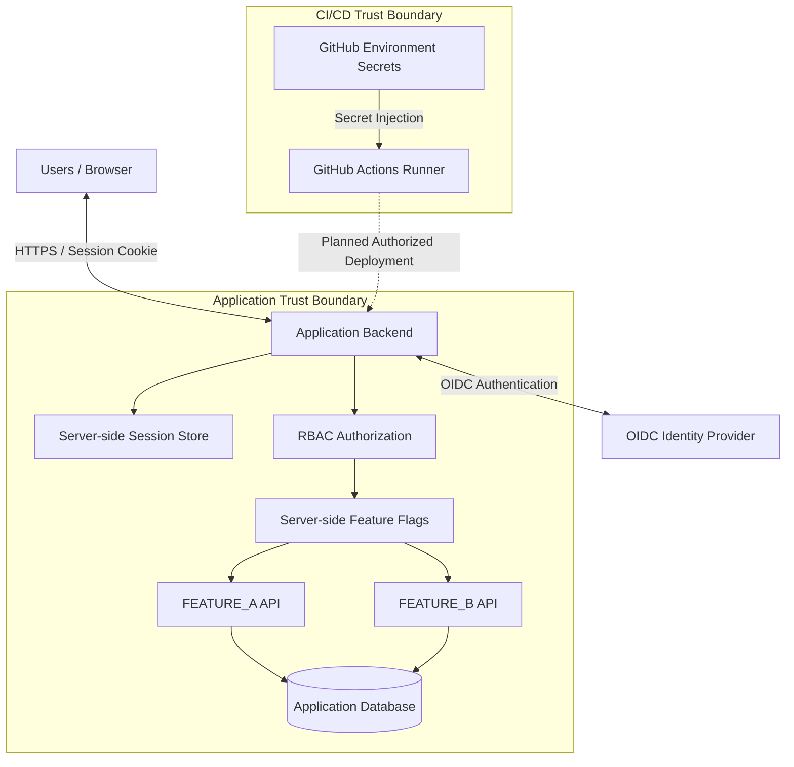

# Assignment 10 — Task 2: Security Design

**Project:** DevOps Final Project  
**Repository:** ntust-devops-group/devops-final-project  
**Assignment:** Team-Based DevSecOps Feature Experiment  
**Role:** Developer  
**Responsible Student:** Chen Yeh-Ting  
**Date:** November 22, 2026  
**Related Issues:** #2, #3, #4

---

## 1. Responsibility and Overview

### 1.1 My Responsibility

As the Developer, I am responsible for Task 2 —
Security Design.

My responsibilities include:

- Task 2-A: Authentication and Authorization
- Task 2-B: Software Composition Analysis (SCA)
- Task 2-C: Secret Management

The objective is to design and validate security
controls for two features managed through feature
toggles in the team's final project.

The security design focuses on authentication,
authorization, software supply chain security,
secret protection, and secure CI/CD practices.

### 1.2 Scope

The security design covers:

1. User authentication using OpenID Connect.
2. Secure server-side session management.
3. Role-Based Access Control (RBAC).
4. Server-side enforcement of feature toggles.
5. Dependency monitoring using GitHub Dependabot.
6. Secure secret storage and CI/CD injection.
7. GitHub Secret Protection and Push Protection.

The final feature names will be supplied by
the Task 3 owner.

Until confirmed, the features are identified as:

- FEATURE_A
- FEATURE_B

### 1.3 Implementation Principle

Security controls must be enforced by trusted
backend components.

Hiding a frontend button does not prevent
unauthorized users from directly calling an API.

All protected operations follow a
deny-by-default authorization policy.

---

## 2. Security Architecture

### 2.1 Architecture Diagram

The following diagram illustrates the proposed
security architecture, major components, trust
boundaries, and secret management flow.



### 2.2 Components

**Users / Browser**

Users interact with the application through
HTTPS connections.

**OIDC Identity Provider**

The identity provider authenticates users
and returns identity information to the backend.

**Application Backend**

The backend validates sessions, checks roles,
evaluates feature flags, and enforces access rules.

**Session Store**

Authenticated sessions are maintained on the
server rather than storing sensitive session
information in browser-accessible storage.

**RBAC Authorization**

The authorization component determines whether
a user's role permits a requested operation.

**Feature Flag Evaluation**

Feature availability is evaluated on the server
before the protected operation is executed.

**Application Database**

The database stores application information.
Access is permitted only through authorized
backend operations.

**GitHub Actions Runner**

CI/CD workflows execute automated tasks and
receive secrets only when explicitly authorized.

**GitHub Environment Secrets**

Sensitive configuration values are stored
outside the source code and injected into
authorized GitHub Actions jobs.

### 2.3 Trust Boundaries

Three important security boundaries are defined.

**Boundary 1: Browser and Backend**

- All communication must use HTTPS.
- The backend must validate each protected request.
- Client-side feature flags cannot grant permissions.

**Boundary 2: Backend and Identity Provider**

- OIDC responses must be validated.
- The application must verify identity tokens.
- Authentication must not automatically grant
  administrative permissions.

**Boundary 3: GitHub CI/CD and Application**

- Secrets must remain outside source code.
- Only authorized jobs may access environment secrets.
- Production deployment requires additional
  authorization and protection controls.

### 2.4 Implementation Status

The application architecture is currently
a security design proposal.

OIDC integration, server-side sessions,
RBAC middleware, and protected feature APIs
have not yet been implemented or verified.

The GitHub security configuration and CI/CD
secret injection controls have been implemented
and tested separately.

---

## 3. Authentication Design

### 3.1 Selected Technology

**Authentication Method:** OpenID Connect (OIDC)

**Login Flow:** Authorization Code Flow with PKCE

OIDC is selected because it provides a
standardized authentication mechanism.

It allows the application to rely on a
trusted identity provider rather than
implementing its own password system.

### 3.2 Authentication Flow

The proposed authentication process is:

1. The user selects Login.
2. The application redirects the user to
   the configured OIDC identity provider.
3. The provider authenticates the user.
4. The provider redirects the browser back
   with an authorization code.
5. The backend exchanges the code using PKCE.
6. The backend validates the returned ID token.
7. The application creates a server-side session.
8. The browser receives a secure session cookie.
9. Protected requests use the authenticated session.

### 3.3 Security Controls

The authentication design includes:

- Authorization Code Flow with PKCE.
- HTTPS communication.
- State validation against login CSRF.
- Nonce validation when applicable.
- ID token issuer and audience validation.
- Signature and expiration validation.
- Registered and validated redirect URIs.
- Secure session creation after authentication.

### 3.4 Reasons for Selection

OIDC was selected because it:

- Reduces the need to store user passwords.
- Supports standardized identity verification.
- Separates authentication from authorization.
- Supports integration with common identity
  providers and modern web applications.

### 3.5 Implementation Status

**Status: Planned**

The OIDC integration is currently designed
but has not been implemented in the backend.

---

## 4. Session Management Design

### 4.1 Selected Method

**Session Type:** Server-side Sessions

Server-side sessions are selected instead of
storing long-lived authentication credentials
directly in browser-accessible storage.

The browser maintains only an opaque
session identifier.

### 4.2 Session Security Controls

The proposed implementation includes:

- HttpOnly session cookies.
- Secure cookie attribute.
- SameSite cookie policy.
- HTTPS for authenticated connections.
- Server-side session expiration.
- Idle session timeout.
- Server-side session revocation.
- Session ID regeneration after login.
- Session invalidation after logout.
- CSRF protection for state-changing requests.

### 4.3 Session Validation

For each protected request:

1. Read the session identifier.
2. Locate the session on the server.
3. Check whether the session is valid.
4. Verify that it has not expired.
5. Retrieve the authenticated user's identity.
6. Continue to authorization checks.

Invalid or expired sessions must be rejected.

### 4.4 Implementation Status

**Status: Planned**

Session security requirements have been defined,
but a production session store and session
middleware have not yet been implemented.

---

## 5. Authorization and Feature Toggle Security

### 5.1 Selected Authorization Model

**Authorization Model:** Role-Based Access
Control (RBAC)

RBAC is selected because it provides a
simple and maintainable way to manage
permissions based on user roles.

### 5.2 Proposed Roles

**Guest**

An unauthenticated user.

**Member**

An authenticated user with standard
application permissions.

**Admin**

An authorized administrator with
additional management permissions.

Roles must be assigned and verified
by trusted server-side components.

Client-provided role information must
not be trusted.

### 5.3 Feature Access Matrix

The following matrix is a provisional
authorization policy.

| Operation | Guest | Member | Admin |
|---|---|---|---|
| FEATURE_A | Deny | Conditional | Conditional |
| FEATURE_B | Deny | Conditional | Conditional |
| Manage flags | Deny | Deny | Allow |

**Conditional** means access is granted only when:

1. The user is authenticated.
2. The user's role has the required permission.
3. The server-side feature flag is enabled.
4. Resource-level authorization succeeds,
   where applicable.

The final role-to-feature mapping must be
confirmed with the Task 3 owner.

### 5.4 Server-side Authorization Process

Every protected API request must perform
the following checks:

1. Authenticate the current session.
2. Retrieve the trusted server-side role.
3. Verify the required permission.
4. Evaluate the feature flag on the server.
5. Verify resource ownership if necessary.
6. Execute the operation only when
   all checks succeed.

If any authorization check fails,
the request must be rejected.

### 5.5 Feature Toggle Enforcement

Feature toggles must not be treated
as security controls by themselves.

For example:

- Disabling a button in the UI is insufficient.
- Direct API requests must also be checked.
- Disabled features must not remain accessible
  through alternative endpoints.
- Unauthorized users must not be able
  to modify feature flag configuration.
- Feature access must follow deny-by-default rules.

### 5.6 Expected Responses

**401 Unauthorized**

The user has not authenticated successfully
or the session is invalid.

**403 Forbidden**

The authenticated user does not have
permission to perform the operation.

**404 Not Found**

May be used when the API contract intentionally
hides a disabled or unavailable feature.

The selected behavior must be applied
consistently across protected endpoints.

### 5.7 Planned Security Tests

The following tests should be implemented
when the backend is available.

| Test Case | Expected Result |
|---|---|
| Guest accesses protected API | Denied |
| Member accesses permitted feature | Allowed if flag is ON |
| Unauthorized member accesses API | Denied |
| Feature flag is OFF | Operation denied |
| User modifies frontend controls | Backend rules still enforced |
| Invalid session is submitted | Request rejected |
| Non-admin modifies feature flags | Denied |

### 5.8 Implementation Status

**Security Policy: Designed**

**Backend Enforcement: Planned**

**Automated Authorization Tests: Planned**

The application-level enforcement will be
integrated after the team confirms the
two feature requirements.

---

## 6. Software Composition Analysis (SCA)

### 6.1 Selected Tool

**Tool:** GitHub Dependabot

GitHub Dependabot was selected to identify
dependency updates and help monitor
known security vulnerabilities.

The implementation includes:

- Dependabot version updates.
- Dependabot alerts.
- Dependabot security updates.
- GitHub dependency monitoring.

### 6.2 Dependabot Configuration

The following configuration was added to:

`.github/dependabot.yml`

```yaml
version: 2

updates:
  - package-ecosystem: "github-actions"
    directory: "/"
    schedule:
      interval: "weekly"
    open-pull-requests-limit: 5
```

This configuration checks GitHub Actions
dependencies for available version updates
on a weekly schedule.

### 6.3 Initial Execution Problem

During the first Dependabot execution,
the following error appeared:

`Dependabot couldn't find a <anything>.yml`

At that time, the repository did not contain
a GitHub Actions workflow that Dependabot
could discover for the configured ecosystem.

### 6.4 Troubleshooting and Resolution

To resolve the issue, I created:

`.github/workflows/a10-security-check.yml`

The workflow checks that the Dependabot
configuration file exists.

It also references `actions/checkout`,
allowing Dependabot to identify and monitor
a GitHub Actions dependency.

The baseline workflow completed successfully.

After the workflow was added, Dependabot
version update jobs also completed successfully.

### 6.5 Dependabot Execution Results

**Validation Date:** November 22, 2026

Observed results:

- Dependabot configuration recognized.
- Security baseline workflow succeeded.
- Dependabot version update jobs succeeded.
- Dependabot generated or updated PR #7.
- A subsequent version update job reported
  no affected pull requests.

PR #7 proposed the following update:

`actions/checkout@v4 -> actions/checkout@v7`

This was a version update recommendation.

It was not identified as a confirmed
high-severity vulnerability.

### 6.6 Dependency Risk Assessment

The repository's Dependabot Alerts page
was reviewed on November 22, 2026.

Observed alert counts:

| Alert Category | Reported Count |
|---|---|
| Critical vulnerabilities | 0 |
| High vulnerabilities | 0 |
| Open Dependabot alerts | 0 |
| Closed Dependabot alerts | 0 |

No high-severity or critical vulnerabilities
were reported in the available Dependabot
alert results at the time of review.

This does not guarantee that the repository
or future application dependencies are
free from vulnerabilities.

### 6.7 Remediation Plan

| Dependency / Scope | Finding | Decision | Reason |
|---|---|---|---|
| actions/checkout@v4 | Major version update proposed | Upgrade after validation | Maintain current dependencies and compatibility |
| Other GitHub Actions dependencies | No high-risk alerts observed | Monitor | Continue checking version updates and advisories |
| Future application dependencies | Not yet assessed | Scan when added | Identify vulnerable application libraries |

**Decision: Upgrade**

For `actions/checkout`, the proposed update
should be reviewed and tested before merging.

Validation steps:

1. Review Dependabot PR #7.
2. Inspect the changed workflow file.
3. Review relevant compatibility requirements.
4. Confirm the workflow works with the new version.
5. Merge only after successful validation.

**Decision: Replace**

If a future dependency contains an
unresolved vulnerability and no safe
upgrade exists, consider a maintained
alternative package.

**Decision: Accept**

Risk acceptance should be considered only
when a documented justification exists.

Any accepted risk should record:

- The affected dependency.
- The identified vulnerability.
- The reason an immediate fix is unavailable.
- Compensating security controls.
- The responsible reviewer.
- The next review date.

No confirmed high-risk dependency currently
requires a documented acceptance decision
based on the available alerts.

### 6.8 Limitations

The current repository mainly contains
GitHub Actions workflows and documentation.

Application-level dependency manifests
have not been confirmed in the reviewed
repository structure.

Additional dependency scans are necessary
when application code is integrated.

Zero Dependabot alerts do not prove
the absence of all software vulnerabilities.

### 6.9 Implementation Status

**Dependabot Configuration: Implemented**

**Version Updates: Successfully Executed**

**Dependabot Alerts: Enabled and Reviewed**

**Remediation Plan: Documented**

**PR #7 Merge Validation: Not Yet Verified**

---

## 7. Secret Management

### 7.1 Selected Secret Storage

**Secret Storage:** GitHub Environment Secrets

GitHub Environment Secrets were selected
because they integrate directly with
GitHub Actions workflows.

They also provide centralized management
of sensitive CI/CD configuration values.

### 7.2 Implemented Environment

The following environment was created:

`a10-security`

The following test secret was added:

`A10_DEMO_SECRET`

The secret contains a non-production
demonstration value.

No production API key or application
credential was required for the test.

### 7.3 CI/CD Secret Injection

A GitHub Actions workflow was created at:

`.github/workflows/a10-secret-injection.yml`

The workflow uses the `a10-security`
environment to retrieve its test secret.

```yaml
name: A10 Secret Injection Test

on:
  workflow_dispatch:

permissions:
  contents: read

jobs:
  test-secret-injection:
    name: Verify Secure Secret Injection
    runs-on: ubuntu-latest
    environment: a10-security

    steps:
      - name: Verify Environment Secret
        shell: bash
        env:
          A10_DEMO_SECRET: ${{ secrets.A10_DEMO_SECRET }}
        run: |
          if [ -z "$A10_DEMO_SECRET" ]; then
            echo "FAIL: Secret is missing."
            exit 1
          fi

          echo "PASS: Secret injection successful."
          echo "Secret value was not displayed."
```

### 7.4 Secret Injection Validation

The GitHub Actions workflow was executed
manually.

**Workflow:** A10 Secret Injection Test

**Job:** Verify Secure Secret Injection

**Observed Status:** Success

The successful workflow execution
demonstrated that the test secret was
available to the authorized job.

The workflow verifies that the secret
is non-empty without printing its value.

This confirms the CI/CD test-secret injection
mechanism, not a production deployment.

### 7.5 Secret Protection

GitHub Secret Protection was enabled
for the public repository.

The repository settings also showed:

**Push Protection: On**

Push Protection helps block pushes
containing supported detectable secrets.

It does not replace secure secret storage,
access restrictions, or credential rotation.

### 7.6 Secret Management Security Decisions

The following controls are required:

1. Never hardcode production credentials.
2. Never commit API keys or passwords.
3. Store sensitive values in GitHub Secrets.
4. Use separate environments where needed.
5. Inject secrets only into authorized jobs.
6. Restrict GitHub Actions token permissions.
7. Avoid displaying secret values in logs.
8. Rotate or revoke compromised credentials.
9. Review access permissions regularly.
10. Apply additional deployment protection
    rules for production environments.

### 7.7 Production Secret Flow

The planned production secret flow is:

1. An administrator stores a secret
   in an approved secret manager.
2. An authorized CI/CD workflow starts.
3. Environment protection rules are evaluated.
4. The authorized job receives the secret.
5. The secret is used only for the required task.
6. The secret value is not written to source code
   or intentionally displayed in workflow logs.

Production application secret delivery will
require a separate runtime configuration
and deployment security design.

### 7.8 Implementation Status

**GitHub Environment: Implemented**

**Test Environment Secret: Implemented**

**CI/CD Secret Injection: Successfully Tested**

**Secret Protection: Enabled**

**Push Protection: Enabled**

**Production Runtime Secrets: Planned**

**Production Rotation and Deployment Controls:
Planned**

---

## 8. Built Now vs. Planned

### 8.1 Built Now

The following security-related work
has been implemented or documented.

| Security Component | Current Status |
|---|---|
| Dependabot configuration | Implemented |
| Dependabot version updates | Tested successfully |
| Dependabot alerts | Enabled and reviewed |
| Security baseline workflow | Tested successfully |
| Dependency remediation plan | Documented |
| GitHub Environment | Created |
| Test Environment Secret | Configured |
| CI/CD secret injection | Tested successfully |
| GitHub Secret Protection | Enabled |
| GitHub Push Protection | Enabled |
| Authentication design | Documented |
| Session security design | Documented |
| RBAC policy | Designed |
| Security architecture diagram | Completed |

### 8.2 Planned

The following items require further
application-level implementation.

| Security Component | Planned Work |
|---|---|
| OIDC authentication | Integrate an identity provider |
| Server-side sessions | Implement session middleware |
| RBAC authorization | Implement role validation |
| FEATURE_A authorization | Integrate backend checks |
| FEATURE_B authorization | Integrate backend checks |
| Feature flag enforcement | Deny disabled API operations |
| Authorization tests | Test unauthorized access |
| Production secrets | Implement runtime delivery |
| Secret rotation | Establish rotation procedures |
| Production deployment | Apply environment protection |

### 8.3 Implementation Summary

The current implementation establishes
a working GitHub security baseline.

Authentication, session management, and
feature-level authorization have been
designed but not yet implemented as
working application backend controls.

This distinction is important because
a successful CI/CD security test does not
prove that application authorization
has been completed.

---

## 9. Team Integration

### 9.1 Connection to Task 1

The Project Manager is responsible for:

- Team coordination.
- Role assignments.
- GitHub Project tracking.
- Task deadlines.
- Final demonstration planning.

My security work is tracked through:

- Issue #2: Authentication and Authorization.
- Issue #3: Dependabot SCA.
- Issue #4: Secret Management.

### 9.2 Connection to Task 3

The Task 3 owner is responsible for:

- Defining two hypotheses.
- Selecting the two feature experiments.
- Configuring feature toggles.
- Demonstrating ON and OFF states.
- Defining success and guardrail metrics.

The Developer provides the security
requirements for these features.

Both feature APIs must verify:

- Authentication status.
- Role permissions.
- Server-side feature flag state.
- Resource permissions where applicable.

### 9.3 Integration Requirements

Before the final demonstration,
the team should confirm:

1. The final names of FEATURE_A and FEATURE_B.
2. Which roles may use each feature.
3. Which API endpoints require protection.
4. Where feature flags are evaluated.
5. How disabled features are rejected.
6. Whether automated security tests pass.

The final demonstration should show
that hiding a feature in the frontend
is not the only access control mechanism.

---

## 10. Challenges and Lessons Learned

### 10.1 Challenges Encountered

**Challenge 1: Repository Permissions**

Initially, I could not access several
repository security configuration settings.

The settings page indicated that
repository management options were unavailable.

After the repository permissions were updated,
I was able to access the required settings.

**Challenge 2: Dependabot Execution Failure**

The first Dependabot version update job failed
because no compatible GitHub Actions workflow
was available for dependency discovery.

I resolved the issue by creating
a security baseline workflow.

After the change, Dependabot completed
its version update jobs successfully.

**Challenge 3: Dependency Risk Interpretation**

Dependabot generated a pull request
for a major GitHub Actions dependency update.

However, an available version update
does not necessarily indicate a known
security vulnerability.

I learned to distinguish version updates
from vulnerability alerts.

**Challenge 4: Separating Design from Implementation**

The authentication and authorization
architecture could be documented before
the final application features were ready.

However, actual server-side access control
cannot be verified without backend
implementation and integration.

### 10.2 Lessons Learned

The assignment demonstrated that
security involves multiple layers.

Important lessons include:

- Authentication and authorization are different.
- Feature toggles do not replace access control.
- Backend authorization is essential.
- Dependabot helps maintain dependencies.
- Zero vulnerability alerts do not guarantee
  that software is completely secure.
- Secrets should remain outside source code.
- GitHub Actions should use least privilege.
- Push Protection reduces the risk
  of accidental credential exposure.
- Security documentation must distinguish
  completed work from planned controls.

### 10.3 Personal Reflection

Through this assignment, I gained
practical experience with GitHub
security settings and CI/CD protection.

I configured Dependabot, investigated
an execution failure, validated
dependency updates, and tested
GitHub Environment Secret injection.

I also learned how to design
authentication and authorization
requirements for feature-toggled systems.

The most important lesson is that
security should be considered during
system design and development,
rather than being added only
after deployment.

---

## 11. References

### GitHub Documentation

GitHub Docs. Dependabot version updates.

https://docs.github.com/en/code-security/concepts/supply-chain-security/dependabot-version-updates

GitHub Docs. Using secrets in GitHub Actions.

https://docs.github.com/en/actions/how-tos/write-workflows/choose-what-workflows-do/use-secrets

GitHub Docs. About secret scanning.

https://docs.github.com/en/code-security/concepts/secret-security/about-secret-scanning

### OWASP

OWASP Cheat Sheet Series.
Authorization Cheat Sheet.

https://cheatsheetseries.owasp.org/cheatsheets/Authorization_Cheat_Sheet.html

OWASP Cheat Sheet Series.
Session Management Cheat Sheet.

https://cheatsheetseries.owasp.org/cheatsheets/Session_Management_Cheat_Sheet.html

### OpenID Connect

OpenID Foundation.
OpenID Connect Core 1.0.

https://openid.net/specs/openid-connect-core-1_0.html

### Project Evidence

GitHub Repository:

https://github.com/ntust-devops-group/devops-final-project

Dependabot Pull Request #7:

https://github.com/ntust-devops-group/devops-final-project/pull/7

Security Design Document:

docs/security-design.md

GitHub Actions Workflows:

- .github/workflows/a10-security-check.yml
- .github/workflows/a10-secret-injection.yml

---

## 12. Conclusion

Task 2 established a documented security
architecture and a working GitHub security
configuration for the final project.

The completed work includes Dependabot
version monitoring, vulnerability alert
review, CI/CD secret injection validation,
and GitHub Push Protection.

Authentication using OIDC, server-side
session management, and RBAC authorization
were selected as the proposed application
security architecture.

The remaining work involves integrating
these controls with the two feature-toggled
functions and validating authorization
at the backend.

Overall, this task demonstrates how
security design, dependency monitoring,
and secret management can be incorporated
into a DevSecOps development workflow.
