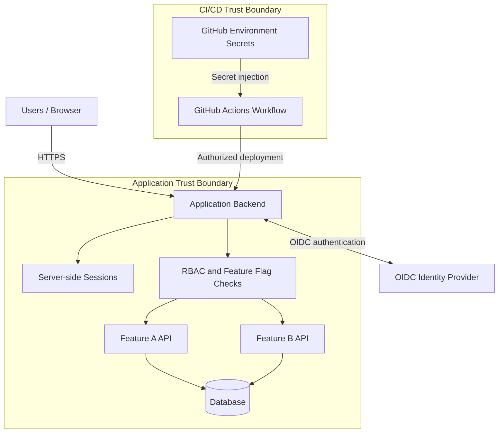

# Assignment 10 — Task 2: Security Design

## 1. Responsibility

Role: Developer
Task: Authentication, Authorization, SCA and Secret Management

This document describes the proposed security controls
for two feature-toggled functions in the team project.

Feature names will be finalized by the Task 3 owner.

## Security Architecture Diagram

The following diagram illustrates the proposed security
architecture, trust boundaries, and secret flow.

**Implementation status:** This is a proposed application
architecture. OIDC, server-side sessions, and RBAC
middleware are planned, not yet implemented.

**Security principle:** All feature access decisions must
be enforced by the backend, not only by hiding UI elements.

## 2. Authentication

Selected method: OpenID Connect (OIDC)
Login flow: Authorization Code Flow with PKCE

Reasons:
- Delegates authentication to a trusted identity provider.
- Avoids storing user passwords in application code.
- Supports standardized identity verification.

## 3. Session Management

Selected method: Server-side sessions

Security controls:
- Secure, HttpOnly and SameSite session cookies.
- HTTPS for all authenticated communication.
- Session expiration and server-side revocation.
- Session ID regeneration after successful login.
- CSRF protection for state-changing operations.

## 4. Authorization

Selected model: Role-Based Access Control (RBAC)

Proposed roles:
- Guest: Unauthenticated user
- Member: Authenticated user
- Admin: Authorized administrator

Feature access rules:

| Operation | Guest | Member | Admin |
|---|---|---|---|
| FEATURE_A | Deny | Conditional | Conditional |
| FEATURE_B | Deny | Conditional | Conditional |
| Manage flags | Deny | Deny | Allow |

Conditional means both the role policy and the
server-side feature flag must allow the operation.

Final role permissions require team confirmation.

## 5. Server-side Enforcement

Every protected API request must:

1. Authenticate the current session.
2. Identify the user's trusted server-side role.
3. Verify the required permission.
4. Check the feature flag on the server.
5. Verify resource ownership where applicable.
6. Deny access if any security check fails.

A hidden frontend button is not authorization.

Default policy: Deny.

Expected responses:
- 401: User is not authenticated.
- 403: Authenticated user is not authorized.
- 404: Feature is unavailable, if the API contract
       intentionally hides disabled features.

## 6. Software Composition Analysis

Tool: GitHub Dependabot

Implemented and observed:
- Dependabot version updates configured.
- GitHub Actions dependency monitoring enabled.
- Dependabot version update jobs succeeded.
- Pull Request #7 proposed an actions/checkout update.
- No open or closed Dependabot vulnerability alerts
  were shown in the reviewed screenshot.

Remediation decision:
- actions/checkout: Evaluate the proposed upgrade.
- Reason: Dependency maintenance and compatibility.
- Validation: Review changes and test the workflow.
- Status: Upgrade proposed; merge not yet verified.

No high-severity or critical Dependabot alerts were
observed in the reviewed snapshot.

A zero-alert result does not prove the absence of
all vulnerabilities.

## 7. Secret Management

Selected storage: GitHub Environment Secrets

Environment: a10-security
Test secret: A10_DEMO_SECRET

Implemented and observed:
- GitHub Environment created.
- Environment Secret added.
- GitHub Actions secret injection test succeeded.
- Secret Protection enabled.
- Push Protection enabled.

Security decisions:
- Do not hardcode production credentials.
- Inject secrets only into jobs that require them.
- Restrict GitHub Actions token permissions.
- Do not print secret values in workflow logs.
- Rotate and revoke compromised credentials.
- Use separate environments for production secrets.

## 8. Built Now vs. Planned

Built Now:
- Dependabot configuration and successful update jobs.
- Security baseline GitHub Actions workflow.
- Test Environment Secret configuration.
- Successful secret injection workflow.
- Repository Push Protection.
- Written security design document.

Planned:
- Integration of OIDC with the application backend.
- Server-side session implementation.
- RBAC middleware integration.
- Server-side authorization for both selected features.
- Automated unauthorized-access and flag-OFF tests.
- Production secret rotation and deployment controls.

## 9. Team Integration

The Task 1 owner manages assignments and timeline.

The Task 2 developer defines and documents security
requirements and validates available security controls.

The Task 3 owner supplies final feature names, toggle
states and expected user permissions.

The final demonstration should verify that disabling
a feature also blocks its backend API operations.

## 10. References

- GitHub Docs: Dependabot
- GitHub Docs: Using secrets in GitHub Actions
- OWASP Authorization Cheat Sheet
- OpenID Connect Core specification
